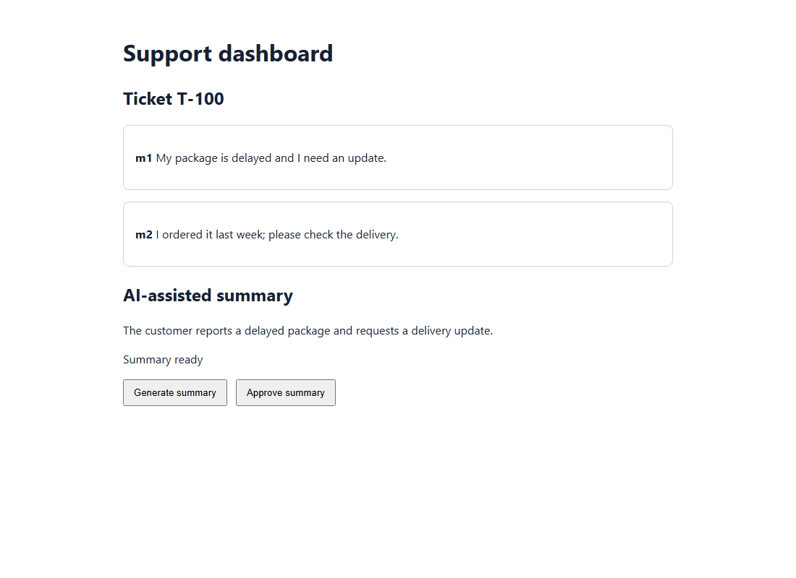

# Playwright AI-summary release gate

A small TypeScript and Playwright project for a synthetic support-ticket summary flow. It runs locally without credentials, paid services, or external AI calls. The browser talks to a local deterministic HTTP service; tests can independently mock that boundary per browser context.

## Application preview

This is a small synthetic test application used to evaluate the Playwright test framework, not a production support dashboard. It displays a sample ticket, generates a deterministic summary through the local service, and enables approval only when the summary passes citation and contact-data checks.



## Setup and run

Requirements: Node.js 22+ and npm.

```sh
npm ci
npx playwright install chromium
npm run typecheck
npm test
```

For the Playwright interactive runner, use `npm run test:ui`.

## Test cases

| Area | Scenario | Expected result |
|---|---|---|
| UI | Valid generated summary with a ticket citation | Summary is shown and can be approved |
| UI | Service reports insufficient information | Message is shown and approval stays disabled |
| UI | Service returns `503`, then succeeds on retry | Retry is offered; approval becomes available after the valid response |
| UI | Summary cites a message from another ticket | Approval stays disabled |
| UI | Summary has no citation | Approval stays disabled |
| UI | Summary includes an email address or phone number | Approval stays disabled |
| Evaluator | Missing or foreign citations, empty text, or contact details | Summary is marked ineligible with a reason |

Page interactions live in `tests/pages/SupportDashboardPage.ts`; each test gets an isolated Playwright page and its own mocked service response, so tests can run in parallel. The tiny local server in `server.mjs` provides a deterministic success response when the app is opened outside the tests.

## Release-blocking criteria

The GitHub Actions workflow runs the TypeScript check and the complete Chromium test suite on pushes and pull requests. Either failing check blocks the `release-gate` job. Each run uploads the Playwright HTML report and test results, including a video for every test, as the `playwright-report-and-videos` artifact. Download it from the completed workflow run on GitHub Actions; open `playwright-report/index.html` to review the report and the videos under `test-results/`.

## Deliberate failure exercise

To observe an intentional regression, temporarily reverse the membership check in `app/summary-evaluator.js` from `!messageIds.has(sourceId)` to `messageIds.has(sourceId)`, then run `npm test`. The valid-summary and cross-ticket-citation tests will fail. Restore the original condition before submitting changes.

## Scope and next steps

The evaluator checks citation membership, presence of a citation and non-empty text, and a basic email/phone leakage pattern. It does not prove that the summary accurately captures meaning, avoids subtler unsupported claims, or detects every sensitive-data format. Those checks need broader adversarial fixtures and, separately, evaluation against a live model with human-reviewed examples; deterministic tests alone cannot establish live-model quality.
